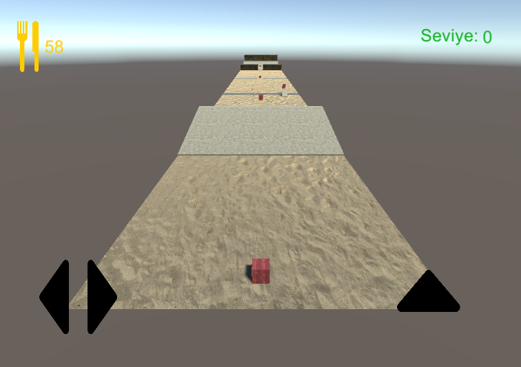
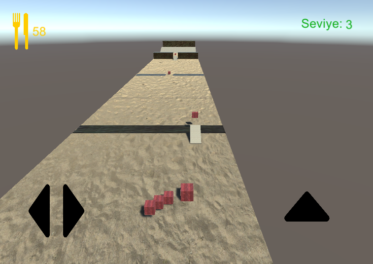
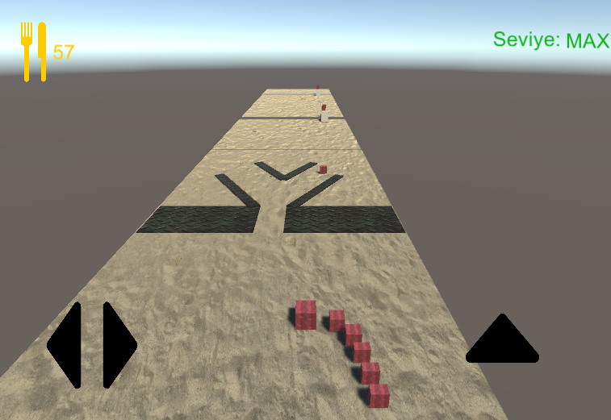
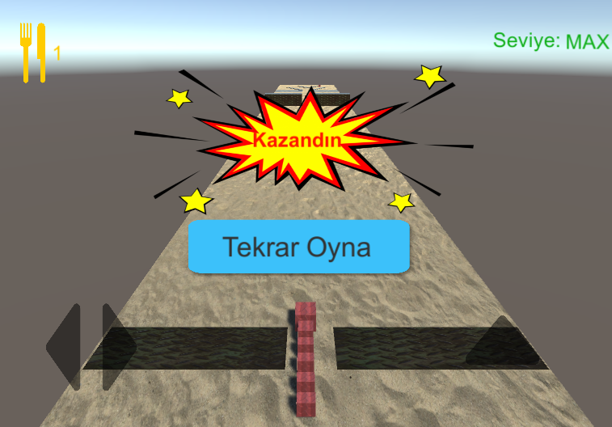
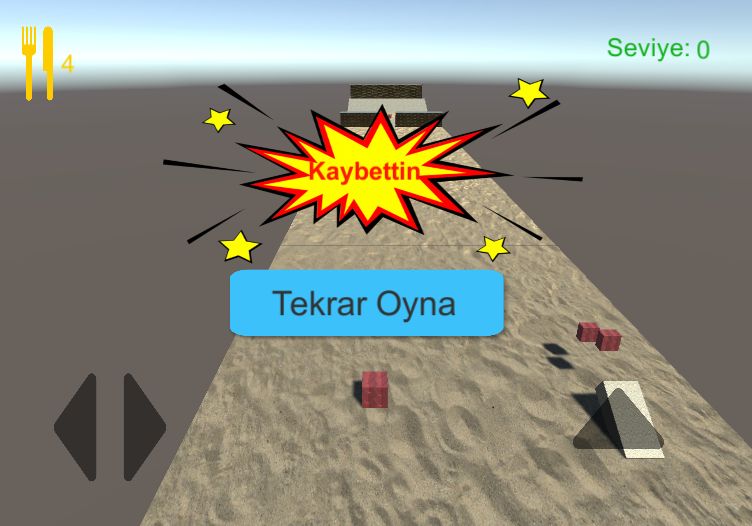

# Snake

Yılanın yem yedikçe seviye atladığı, engellere çarptıkça seviye kaybettiği bir koşu oyunu.

## Neden?

Klasik yılan oyununu, mobil koşu oyunlarındaki ilerle, topla ve engelden kaç yapısına uyarlamak için yapıldı.

## Oynanış

- Yılan ileri doğru ilerliyor, oyuncu yoldaki tüm yemleri yemeye çalışıyor.
- En üst seviyeye ulaşılmadıysa yenen yemler yılanın seviyesini artırıyor. En üst seviyeye ulaşıldıktan sonra bir sonraki seviye için gereken yem sayısı azalıyor.
- Yılanın seviyesi kuyruğunda görünüyor.
- Yılan bir engele çarparsa seviyesi düşüyor. Birinci seviyedeyken engele çarparsa ölüyor.

## Ekranlar

| Kuyruktaki seviye | Engel |
|---|---|
|  |  |
| **Kazanma** | **Tekrar dene** |
|  |  |

## Teknik

| | |
|---|---|
| **Motor** | Unity 2021.3.7f1 |
| **Kod** | `Assets/kodlar` (yılan hareketi, takip eden kuyruk, kamera, bölüm üretme) |
| **GitHub'a yükleme** | Mart 2023 |
